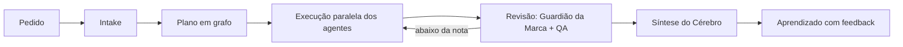
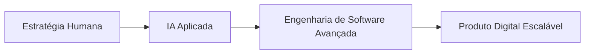

---

---

---

<h1 align="center"> Arquiteto WEB • Desenvolvedor SaaS • Soluções com Inteligência Artificial</h1>

Criação de plataformas • sistemas inteligentes • experiências digitais escaláveis impulsionadas por Inteligência Artificial.

---
---

## 👨‍💻 Sobre mim

Sou **Samuel Bortoleto de Souza**, especialista em desenvolvimento de experiências digitais premium, arquitetura de sistemas SaaS e soluções impulsionadas por Inteligência Artificial.

Minha abordagem combina:
- 🎯 Estratégia
- 🧠 IA aplicada
- ⚙️ Engenharia de software
- 🎨 Design minimalista
- 🚀 Performance e escalabilidade

Atuo no desenvolvimento de:
- Plataformas SaaS modernas
- Sistemas empresariais inteligentes
- Landing pages de alta conversão
- Estruturas Web escaláveis
- Integrações com IA
- Soluções focadas em performance e experiência do usuário

---

## 🚀 Especialidades

- 🏗️ Arquitetura WEB Premium
- ⚡ Desenvolvimento SaaS
- 🤖 Inteligência Artificial aplicada
- 📈 Sistemas escaláveis
- 🎨 UI/UX Minimalista
- 🌐 Aplicações Full Stack
- ☁️ Infraestrutura moderna
- 🔗 APIs e integrações inteligentes
- 🧩 Sistemas multiagentes com IA

---

## 🧠 Projeto em destaque: KODA · cérebro de marketing

O **KODA** é um time de agentes de IA que trabalha como o departamento de marketing de uma empresa. Você conversa com **uma** inteligência (o Cérebro); por trás, **17 especialistas** planejam, escrevem, desenham, revisam e aprendem com o feedback. Um agente de **RH** detecta lacunas no time e contrata novos especialistas sozinho.

**Como o cérebro pensa**

**O que o sistema entrega**

- 🧠 **Cérebro 3D de partículas** que reage à conversa e acende o departamento que está trabalhando, com mapa vivo do time (constelação, órbitas e fluxo)
- 💬 **Chat com o Cérebro**: briefing, copy com variações, conceito, spec de design, moodboard, cronograma e roteiro
- 👥 **Agentes em pixel art** com status, logs em tempo real, KPIs e versões de prompt, além do painel de RH
- 📅 **Calendário editorial** com fluxo ideia → rascunho → aprovado → agendado → publicado, e medição automática 48 h depois
- 🎨 **Estúdio de criativos**: artes com o DNA da marca, revisão do Guardião (contraste, zona segura, claims) e templates do Canva
- 📸 **Instagram**: o que converte por formato, dia, horário e tema; caixa de **comentários** com respostas sugeridas no tom da marca
- 🛰️ **Radar de mercado**: monitora sites e notícias de concorrentes e sugere como responder
- ✅ **Aprovação do cliente** por link, sem login, e **relatório mensal** em PDF
- 🏢 **Várias marcas** na mesma conta, cada uma com DNA, base de conhecimento, time e calendário próprios
- 🔔 **Alertas** no Slack e no WhatsApp
- 🗣️ **Voz e 21 humores**: a IA fala as respostas (ElevenLabs, OpenAI ou navegador) e muda de tom conforme o dia

**Engenharia**

- Next.js 16 (App Router) + TypeScript, React Three Fiber, Motion e Tailwind 4
- Claude API com saídas estruturadas (Zod), cache de prompt no DNA da marca e modos de economia de tokens
- Supabase (Postgres + Realtime + Storage) como fonte de verdade, com fallback local e gravação incremental
- Login com sessão assinada (HMAC), senhas em scrypt, chaves cifradas (AES-256-GCM) e limite de tentativas
- Integrações com Anthropic, OpenAI, Canva, Pinterest, Instagram, Slack e WhatsApp
- Salvaguardas: nada é publicado, enviado ou pago sem aprovação humana; orçamento diário de IA e botão "parar tudo"
- Deploy em VPS com PM2 + Nginx + https

---

## 📅 Atividades recentes

**29/10/2026**

- 🚀 Publicação da **primeira versão do KODA** no GitHub: 201 arquivos e mais de 34 mil linhas de código
- 🗄️ Migração da persistência do KODA para o **Supabase** (banco, tempo real e storage), com backup completo antes da virada
- 🧪 Testes automatizados de acesso, calendário, estúdio, marcas, radar e comentários
- 🎨 Peças de comunicação para a **THOR Componentes**: comunicado de entrevistas, processo seletivo da unidade de borrachas, aviso de férias e stories para o Instagram

---

## 🧠 Filosofia de Construção

> “Tecnologia não deve apenas funcionar.
> Ela deve transmitir presença, performance e experiência.”

---

## 📊 Objetivos atuais

- 🚀 Construção de produtos SaaS escaláveis
- 🤖 Integração de IA em aplicações reais
- 🧠 Evolução do KODA: deploy em produção e novas marcas
- 🌐 Desenvolvimento de ecossistemas digitais modernos
- ⚡ Criação de experiências para empresas e marcas

---

## 📌 Diferenciais

✔️ Estruturas modernas e performáticas  
✔️ Visual sofisticado e minimalista  
✔️ Desenvolvimento orientado à escalabilidade  
✔️ Integração com Inteligência Artificial  
✔️ Foco total em experiência do usuário  
✔️ Arquitetura limpa e profissional  

---

## 🌍 Visão

Criar sistemas e experiências digitais que unem:
- Engenharia
- Design
- Inteligência Artificial
- Escalabilidade
- Performance

Transformando ideias em produtos digitais sólidos e inteligentes.

---

---

## 🤖 IA como camada estratégica de engenharia e aceleração de produtos digitais

Utilizo Inteligência Artificial como parte central do processo de **arquitetura e desenvolvimento de software**, elevando performance, eficiência e escalabilidade de sistemas modernos.

---

## ⚙️ Aplicações principais da IA

A Inteligência Artificial permite automatizar processos, analisar grandes volumes de dados, otimizar operações e acelerar decisões estratégicas dentro das empresas. Suas principais aplicações envolvem automação inteligente, atendimento automatizado, análise de dados, personalização de experiências, geração de conteúdo, integração de sistemas e otimização de performance operacional.

Os benefícios incluem aumento de produtividade, redução de custos, escalabilidade, ganho de eficiência, melhoria na tomada de decisões e criação de experiências mais inteligentes, modernas e competitivas para empresas e clientes.

---

## 🧠 Metodologia de Desenvolvimento

