<picture>
  <source media="(prefers-color-scheme: dark)" srcset="https://capsule-render.vercel.app/api?type=waving&color=0:0D1117,100:B8F028&height=140&section=header">
  
</picture>

<picture>
  <source media="(prefers-color-scheme: dark)" srcset="https://readme-typing-svg.herokuapp.com?font=Orbitron&weight=700&size=28&duration=3000&pause=1000&color=B8F028&center=true&vCenter=true&width=900&lines=MARKETING+DIGITAL;TRÁFEGO+PAGO;KODA+·+CÉREBRO+DE+MARKETING+COM+IA">
  
</picture>

<h3>Samuel Bortoleto · Marketing, Tráfego Pago e IA</h3>

Uno estratégia de marketing, mídia paga e engenharia de software para gerar resultado com IA.

---

## 🎯 O que eu faço

**📣 Marketing**
Estratégia de marca, posicionamento, calendário editorial, copy e criativos para redes sociais.

**💰 Tráfego pago**
Campanhas no Meta Ads e no Google Ads, segmentação de público, testes de criativos, otimização de custo por lead e relatórios de desempenho.

**🤖 IA e sistemas**
Automação de marketing com IA, landing pages de alta conversão e plataformas SaaS sob medida.

---

## 🧠 KODA · cérebro de marketing com IA

> Projeto autoral: criei, desenvolvi e mantenho o KODA do zero.

O **KODA** é um departamento de marketing feito de agentes de IA. Você conversa com **uma** inteligência, o Cérebro, e por trás dele **17 especialistas** planejam, escrevem, desenham, revisam e aprendem com o feedback. Um agente de **RH** percebe lacunas no time e contrata novos especialistas sozinho.

**Um pedido, do comando à aprovação**

**Principais recursos**

- 💬 Chat com o Cérebro: briefing, copy com variações, conceito, roteiro e cronograma
- 📅 Calendário editorial da ideia à publicação, com medição automática 48 h depois
- 🎨 Estúdio de criativos com o DNA da marca e revisão de contraste, zona segura e claims
- 📸 Instagram: o que converte por formato, dia, horário e tema, e respostas sugeridas para comentários
- 🛰️ Radar de mercado que monitora concorrentes e sugere como responder
- ✅ Aprovação do cliente por link e relatório mensal em PDF
- 🏢 Várias marcas na mesma conta, cada uma com DNA, time e calendário próprios
- 🔒 Nada é publicado, enviado ou pago sem aprovação humana

---

## 📈 Marcos recentes

- **KODA 1.0 lançado:** arquitetura multiagente com 17 especialistas, mais de 34 mil linhas de código e infraestrutura em Supabase
- **THOR Componentes:** comunicação institucional, endomarketing e campanhas de recrutamento
- **Próxima etapa:** KODA em produção, atendendo novas marcas

**Quer mais resultado com marketing, tráfego pago ou IA no seu negócio?**
[Fale comigo no WhatsApp](https://wa.me/5544997647379)

<picture>
  <source media="(prefers-color-scheme: dark)" srcset="https://capsule-render.vercel.app/api?type=waving&color=0:B8F028,100:0D1117&height=100&section=footer">
  
</picture>
